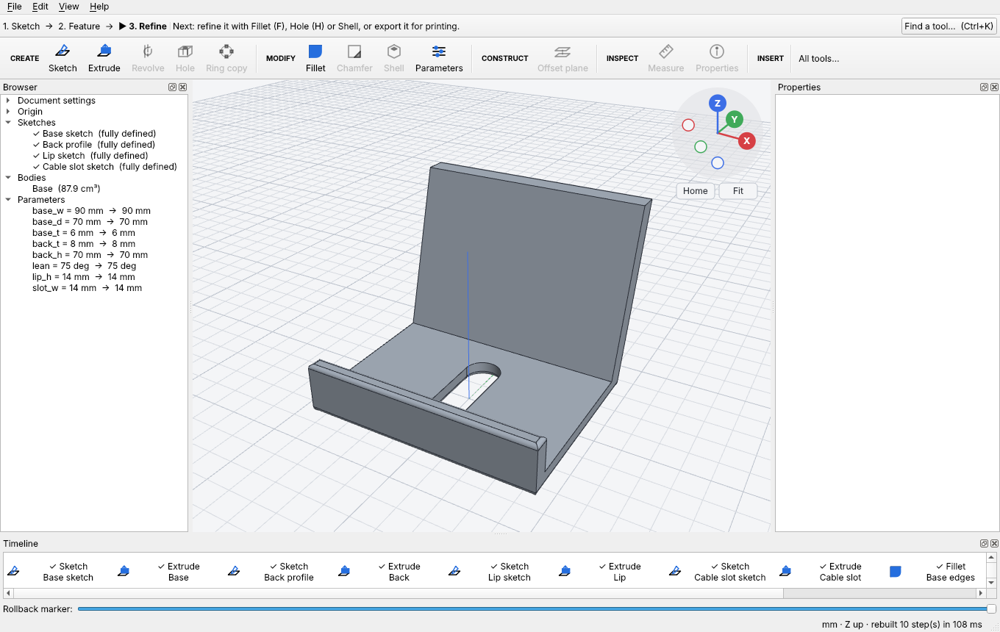
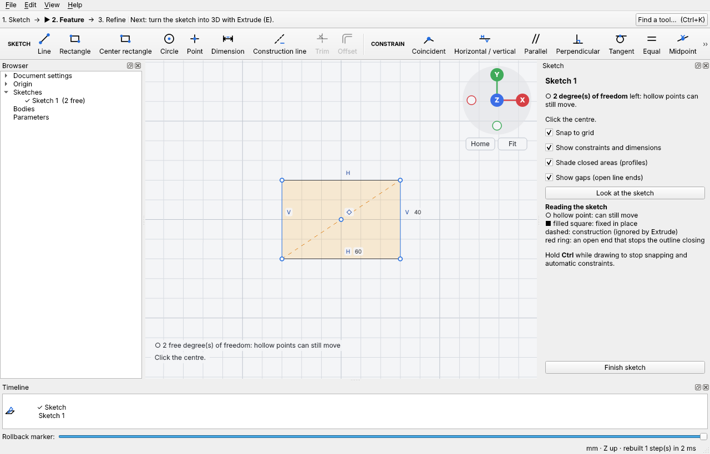
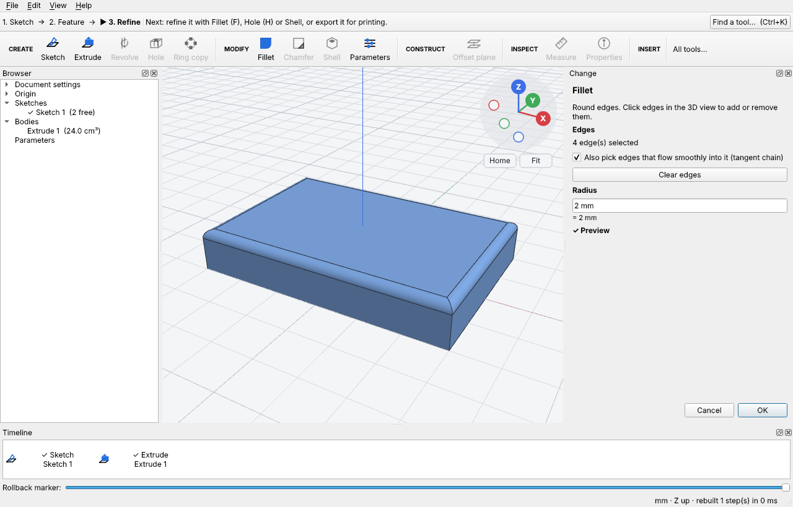

# Jigsmith

**Free, open-source parametric 3D CAD for hobbyists and makers**, on Linux, Windows and macOS.
Sketch, extrude, refine, with a timeline of editable steps. No account, no cloud, no
telemetry, no paywall. Your designs are files on your computer.



| Sketching | Fillet with live preview |
|---|---|
|  |  |

> **Status: early development (pre-v0.1).** You can sketch, extrude and fillet a part in
> the app, edit any step later, and export it. Many v0.1 tools (Revolve, Hole, Shell,
> patterns…) are still being built. See [docs/STATUS.md](docs/STATUS.md) for exactly what
> works today and how it was verified. Tools that are not ready are shown disabled with
> the milestone they arrive in.

## Download a development build

Every green build of the development branch is published as the
[**continuous** pre-release](https://github.com/Redgale/Multi-OS-modeling-software/releases/tag/continuous)
(no GitHub account needed):

| Platform | File |
|---|---|
| Linux x86_64 (glibc) | `Jigsmith-linux-x86_64.AppImage`: `chmod +x` it and run |
| macOS Apple silicon | `Jigsmith-macos-15.dmg` |
| macOS Intel | `Jigsmith-macos-15-intel.dmg` |
| Windows x64 | `Jigsmith-windows-x64-portable.zip`: unzip, run `jigsmith.exe` |

They are unsigned, so macOS Gatekeeper and Windows SmartScreen will warn the first time.
On Void (especially musl), Alpine or other distributions where the AppImage does not
run, build from source; it takes a few minutes.

## What works today

- **Sketch** on a plane or a flat face: Line, Rectangle (corner or centre), Circle, Point,
  Dimension, construction lines, and constraints (coincident, horizontal/vertical, parallel,
  perpendicular, tangent, equal, midpoint, symmetry, fix). Type sizes while drawing (Tab
  between fields), drag geometry with the live solver, and see what is still free: hollow
  points can move, filled squares are fixed. Gaps in an outline are ringed in red.
- **Extrude** with a live preview: distance or through everything, one side, other side or
  symmetric, and Join / Cut / New body / Intersect, with **Auto** choosing Join or Cut.
- **Fillet** by clicking edges (tangent chains in one click). A radius that is too big is
  explained, with a one-click working value.
- **Edit any step** later (double-click it in the timeline), rename, suppress, roll back,
  delete with a warning about steps that depend on it; **Parameters** table with units and
  expressions; unlimited undo.
- Open the built-in **phone stand** sample (File ▸ Open a sample).
- Save and open `.jig` designs; export **STL** (binary) and **STEP**.
- Find any tool by intent: **Ctrl+K** (⌘K on macOS) or **S**, then type “round the edges”.
- Headless modelling with scripts: `jigsmith-cli --run samples/phone_stand.jigs --report -`.
- Change a parameter early in the timeline and later fillets and sketches stay attached
  (tested in CI).

## Build from source

You need a C++20 compiler, CMake ≥ 3.24, Ninja, and the dependencies below. Every platform
uses prebuilt dependencies, so a typical machine builds Jigsmith in 5 to 15 minutes.

### Linux (any distribution)

`scripts/install-deps.sh` installs the dependencies with your package manager. It knows
**Debian/Ubuntu, Void (glibc and musl), Fedora, Arch and openSUSE Tumbleweed**, and each of
those is built and tested in CI inside the distribution's official container image. Run
it with no arguments to see the exact command before anything is installed:

```bash
scripts/install-deps.sh
```

For example, on **Void Linux** it runs:

```bash
sudo xbps-install -Sy base-devel cmake ninja pkg-config occt-devel qt6-base-devel eigen boost-headers json-c++ gtest-devel tbb-devel MesaLib-devel
```

Then build, test and run (same on every distribution):

```bash
cmake -S . -B build -G Ninja -DCMAKE_BUILD_TYPE=Release
```

```bash
cmake --build build && ctest --test-dir build
```

```bash
./build/app/jigsmith
```

**No Open CASCADE package on your distribution** (or one older than 7.6)? Build it into
`./deps/occt` first (only the parts Jigsmith needs; about 15 to 40 minutes), then point
CMake at it:

```bash
scripts/build-occt.sh
```

```bash
cmake -S . -B build -G Ninja -DCMAKE_BUILD_TYPE=Release -DCMAKE_PREFIX_PATH="$PWD/deps/occt"
```

Other distribution not listed? Install the equivalents of: a C++20 compiler (GCC ≥ 13
or Clang ≥ 17), CMake ≥ 3.24, Ninja, OCCT ≥ 7.6 development files, Qt 6 base development
files, Eigen 3, Boost headers, nlohmann/json, GoogleTest and OpenGL headers.

### macOS (Apple silicon or Intel, Homebrew)

```bash
brew install cmake ninja opencascade qt eigen boost nlohmann-json googletest
```

```bash
cmake -S . -B build -G Ninja -DCMAKE_BUILD_TYPE=Release -DCMAKE_PREFIX_PATH="$(brew --prefix qt);$(brew --prefix)"
```

```bash
cmake --build build && ctest --test-dir build
```

```bash
open build/app/jigsmith.app
```

### Windows 10/11 (Visual Studio 2022, conda-forge, Qt)

1. Install Visual Studio 2022 with “Desktop development with C++”,
   [Miniforge](https://github.com/conda-forge/miniforge) (for prebuilt Open CASCADE), and
   Qt 6.8 (open-source edition, “MSVC 2022 64-bit”) from the Qt online installer.
2. Open the “Miniforge Prompt”, create the dependency environment once (about two minutes):

```bash
conda env create -f packaging/windows/environment.yml
```

3. In the same prompt, activate it and load the compiler (adjust the VS path if needed):

```bash
conda activate jigsmith && "C:/Program Files/Microsoft Visual Studio/2022/Community/VC/Auxiliary/Build/vcvars64.bat"
```

4. Configure, build and test (adjust the Qt path to your install):

```bash
cmake -S . -B build -G Ninja -DCMAKE_BUILD_TYPE=Release "-DCMAKE_PREFIX_PATH=%CONDA_PREFIX%/Library;C:/Qt/6.8.3/msvc2022_64"
```

```bash
cmake --build build && ctest --test-dir build
```

### Build options

| Option | Default | Meaning |
|---|---|---|
| `JIG_BUILD_GUI` | ON | Build the Qt app (turn off for a headless core + CLI) |
| `JIG_BUILD_TESTS` | ON | Unit, geometry, naming and file-format tests |
| `JIG_BUILD_BENCH` | ON | `jigsmith-bench` performance budgets |
| `JIG_SANITIZE` | empty | e.g. `address,undefined` for the core and tests |

## Project layout

| Path | What |
|---|---|
| `core/` | `jig_core`: the headless library (document, sketches, features, kernel, files) |
| `cli/` | `jigsmith-cli`: run scripts, open designs, print reports |
| `app/` | The Qt desktop application (a thin layer over `jig_core`) |
| `tests/`, `bench/` | GoogleTest suites and performance budgets |
| `samples/` | Sample designs as scripts (`.jigs`) |
| `third_party/planegcs/` | FreeCAD's sketch solver, vendored |
| `docs/` | Status, decisions, architecture, plans |

Read [ARCHITECTURE.md](ARCHITECTURE.md) before changing the core, and
[CONTRIBUTING.md](CONTRIBUTING.md) before opening a pull request.

## License

Jigsmith is free software under the **GNU GPL v3 or later** ([LICENSE](LICENSE)).

**Jigsmith uses Open CASCADE Technology** (https://dev.opencascade.org), licensed
under the LGPL 2.1 with an additional exception. It also uses planegcs from FreeCAD, Qt,
Eigen, Boost, nlohmann/json and miniz; see [THIRD_PARTY_LICENSES.md](THIRD_PARTY_LICENSES.md).

Jigsmith is an independent project. It is not affiliated with or endorsed by Autodesk;
tool names such as Extrude and Fillet are generic CAD terms.
